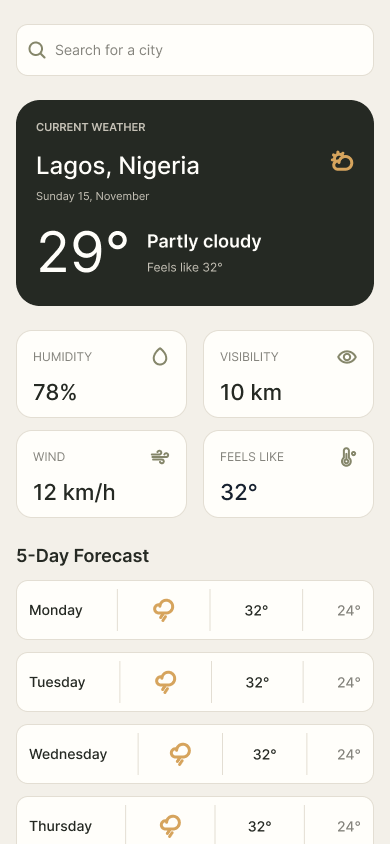

# Atmos

> A clearer view of the weather. Wherever you are.

Atmos is a responsive weather web application built with HTML5, CSS3 and
vanilla JavaScript. It uses the Open-Meteo Geocoding API for city search and
the Open-Meteo Forecast API for current conditions and the five-day forecast.

## Live demo and repository

**[Live Demo — ATMOS weather app](https://azeezayoola-dev.github.io/atmos-weather-app/)**

[View the source on GitHub](https://github.com/AzeezAyoola-dev/atmos-weather-app)

## Screenshots

| Home dashboard | Search locations |
| --- | --- |
|  |  |

| Search results | Selected city weather |
| --- | --- |
|  |  |

## About the project

ATMOS is a responsive, client-side weather application. Users can view live
current conditions on the HOME dashboard (Lagos, Nigeria), search for cities,
open a separate SELECTED WEATHER view with a five-day forecast, and revisit
their recent searches.

Its purpose is to make current conditions and the next five days easy to read
on both small and large screens while preserving the approved warm-palette
Figma design. All weather and geocoding data come live from Open-Meteo: the
Geocoding API powers city search, and the Forecast API supplies current
conditions and daily forecasts. There is no backend, framework or build step.

## Features

- Fixed Lagos, Nigeria HOME dashboard with live current conditions.
- City search using Open-Meteo geocoding with debounced results and validation.
- Separate SELECTED WEATHER state for searched cities, independent of HOME.
- Five-day forecast with per-day WMO weather icons and labelled highs/lows.
- Recent searches persisted in `localStorage`, newest first.
- Graceful loading, empty, no-results, network-error, retry and not-found states.
- Accessible three-screen navigation, visible focus, live announcements and
  reduced-motion support.
- Responsive warm-palette design preserved from the approved Figma screens.

## Technologies

- HTML5
- CSS3
- Vanilla JavaScript (ES modules)
- Open-Meteo Geocoding API
- Open-Meteo Forecast API for current conditions and five-day forecast
- Browser `fetch`, `AbortController` and `localStorage`

No frameworks, no backend and no package dependencies. Recent searches are
persisted with `localStorage` under `atmos.recentCities.v1`.

## Design decisions

The approved Figma screenshots in `design/screenshots/` are the visual source
of truth. The **warm palette** from those screenshots is authoritative.

- Warm palette from the screenshots.
- Centred, responsive desktop shell that preserves the mobile composition.
- Compact `ATMOS` wordmark.
- Date and time use the selected city's local timezone.
- Five-day forecast is today plus the following four days.
- Inter typography, with a system sans-serif fallback.
- Celsius, wind speed in km/h, and labelled forecast highs and lows.
- Temperature typography: 56px/64px on mobile, 80px/88px on larger screens.
- Normal-size error text uses `--app-text` for contrast; the amber accent is
  reserved for non-text forecast icons and the retry hover border.
- Visible focus, 44px minimum hit targets and reduced-motion support were added
  without changing the approved layout.

Reference files:

- PRD: `documentation/ATMOS-PRD.md`
- Product requirements PDF: `documentation/ATMOS_Product_Requirements_Document_v1.pdf`
- Design tokens: `design/design-tokens.tokens (2).json`
- CSS tokens: `css/variables.css`
- Screenshots: `design/screenshots/`

## Project structure

```text
ATMOS/
├── index.html
├── css/
│   ├── variables.css      Existing design tokens
│   └── style.css          Shell and screen styles
├── js/
│   ├── app.js             Entry point, view switching and orchestration
│   ├── api.js             Open-Meteo geocoding, current and daily requests
│   ├── weather.js         Weather codes, formatting and dashboard rendering
│   ├── search.js          Validation, debounce, rendering and selection
│   ├── state.js           Independent HOME/SELECTED state and error slices
│   └── storage.js         Recent-search persistence and validation
├── assets/
├── design/                Existing tokens and screenshots
├── documentation/         PRD and development log
└── README.md
```

## Accessibility and testing

The main results are summarised here; the full implementation and QA record is
in the [ATMOS development log](documentation/ATMOS-Development-Log.md).

- Phase 9 browser suite: **294/294 checks passed** at 320px, 375px, 390px and
  1440px, covering slow networks, failed geocoding, invalid/no-result searches,
  HOME and selected-city current/forecast failures, every retry path, empty
  recents, refresh, navigation and per-day forecast icons on both weather
  screens.
- Phase 10 accessibility and responsive audit: **182/182 checks passed** across
  26 viewport/state snapshots at 320px, 375px, 390px, 768px, 1024px and
  1440px, with **0 axe-core violations**, **0 console errors** and **0
  uncaught exceptions**.
- Regressions: Phase 5 **45/45**, Phase 6 **56/56**, Phase 7 **58/58**, Phase 8
  **37/37**, state separation **164/164**, forecast icons **129/129**.
- Verified fixes: the search error hint now uses `--app-text` (12.99:1 on
  `#F3F0E9`), the skip link and recent-search chips meet the 44px minimum
  target, focus is visible on every control, focus moves correctly after
  selection and navigation, and reduced motion is respected.
- JavaScript module syntax checks and `git diff --check` pass.

## Deployment

**Live app:** <https://azeezayoola-dev.github.io/atmos-weather-app/>

**Source repository:** <https://github.com/AzeezAyoola-dev/atmos-weather-app>

**Phase 11 — published and verified.** The approved app is live via GitHub
Pages from `main` at the site root (`/`). The repository contains **17 commits**
on `main` (verified with `git rev-list --count HEAD`), and the approved Phase 10
files were pushed unchanged; only README presentation and ignore rules were
added for delivery. All commits and the approved design are preserved.

No build step or environment variable is required: `index.html` is the entry
point and all CSS/JavaScript paths are relative. Live checks passed for real
Open-Meteo data, search, navigation, recent searches, loading/error states and
responsive layout:

- The deployed HTML, CSS and six ES modules return HTTP 200 with correct
  content types.
- Real Open-Meteo smoke test on the deployed origin: HOME showed Lagos, Nigeria
  with live current weather and five forecast rows; searching Abuja showed the
  selected city with its own live weather and WMO icons; back navigation
  returned HOME to Lagos; the recent list updated; no console errors or
  uncaught exceptions occurred.
- Full Phase 10 audit against the deployed origin: **182/182 checks passed**
  across the six required widths, with 26 viewport/state snapshots, **0
  axe-core violations**, **0 console errors** and **0 uncaught exceptions**.
- Loading state: the card and forecast list were busy, five placeholder rows
  were shown, then the page resolved to live data with no retry visible.
- Error states: HOME current-weather failure showed a friendly message and
  retry; a forecast-only failure kept current weather and showed a
  forecast-specific message, unavailable rows and a retry. Search failure was
  covered by the Phase 10 accessibility audit.
- Recent-search persistence: a city selected through real geocoding remained
  in storage and reappeared as a recent chip after a full page refresh.

The complete Phase 11 verification record is in the
[development log](documentation/ATMOS-Development-Log.md#phase-11-deployment-verification).

## Local setup

1. Clone the repository:

   ```bash
   git clone https://github.com/AzeezAyoola-dev/atmos-weather-app.git
   cd atmos-weather-app
   ```

2. Serve the project root over HTTP. Because the app uses ES modules, opening
   `index.html` directly with `file://` will not work. Any static server is
   sufficient, for example:

   ```bash
   npx serve .
   ```

   Or use the VS Code Live Server extension and open `index.html`.

3. Open the local URL printed by the server (usually `http://localhost:3000`
   or `http://127.0.0.1:5500`). No build step, package install or environment
   variable is required.

Deployment uses the same static root: `index.html` is the entry point and all
CSS/JavaScript paths are relative.

## API attribution

Weather and geocoding data are provided by
[Open-Meteo](https://open-meteo.com/):

- [Open-Meteo Geocoding API](https://open-meteo.com/en/docs/geocoding-api) —
  city search.
- [Open-Meteo Forecast API](https://open-meteo.com/en/docs) — current weather
  and five-day forecast.

Open-Meteo is free for non-commercial use and requires no API key. ATMOS sends
no credentials to any service. Typography is loaded from Google Fonts using the
public Inter stylesheet.

## Known limitations

- Weather and recent-search data are in-memory or `localStorage` only; there is
  no offline cache or service worker, so a refresh requires a working
  connection to repopulate weather.
- Error and loading states are intentionally session-local and are not
  persisted across refresh. A refresh returns to HOME with Lagos.
- Open-Meteo rate limits and upstream outages remain outside the app's control;
  the app reports them and offers retry rather than caching stale forecasts.
- City search still requires at least two characters and relies on the
  geocoding provider's available names and spelling.
- No physical phone was available: testing used Chrome device-metric emulation,
  not an actual phone. Touch, viewport and reduced-motion checks are emulation
  results, not real-device results.
- axe-core 4.10.2 and scripted keyboard checks do not replace manual testing
  with NVDA, VoiceOver or another screen reader; no screen reader was available
  in this environment.
- Live API values change over time; smoke-test results are point-in-time
  checks, not fixed expected data.
